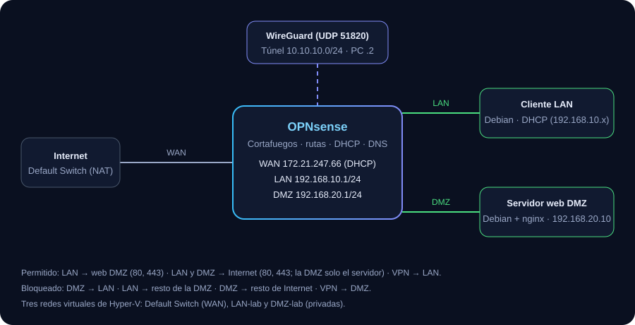

# Red segura de laboratorio (cortafuegos, DMZ y VPN)

Proyecto de redes y seguridad: un cortafuegos con tres zonas (LAN, DMZ y WAN) y una VPN, todo en máquinas virtuales y a coste 0 €.

**Estado:** montado, probado y documentado. Las máquinas se quedan en mi PC; aquí están la configuración, las pruebas y las capturas.

**Ver la página en vivo:** https://albeertx.github.io/portfolio/06%20Red%20segura%20de%20laboratorio/web/

El código de la página está en [web/index.html](web/index.html).

## Qué hice

- Activé **Hyper-V** en Windows 11 Pro y creé dos redes privadas, `LAN-lab` y `DMZ-lab`. La WAN usa el `Default Switch`, que da salida a Internet por NAT.
- Instalé **OPNsense 26.7** en una VM con tres tarjetas de red: WAN, LAN y DMZ.
- Monté un **servidor web** (Debian 13 con nginx) en la DMZ, con IP fija `192.168.20.10`.
- Monté un **cliente** (Debian 13) en la LAN, que recibe la IP por DHCP de OPNsense.
- Escribí las **reglas del cortafuegos** con política de "todo denegado salvo lo permitido".
- Configuré una **VPN WireGuard** que da acceso a la LAN pero no a la DMZ.
- Probé cada regla desde las máquinas y comprobé los bloqueos en el registro del cortafuegos.

## Direcciones

| Máquina | Red | Dirección |
|---|---|---|
| OPNsense (WAN) | Default Switch | 172.21.247.66 (DHCP) |
| OPNsense (LAN) | LAN-lab | 192.168.10.1/24 |
| OPNsense (DMZ) | DMZ-lab | 192.168.20.1/24 |
| Cliente LAN | LAN-lab | 192.168.10.x por DHCP (en las pruebas, .177) |
| Servidor web | DMZ-lab | 192.168.20.10 (fija) |
| VPN WireGuard | túnel | 10.10.10.1/24 (cortafuegos), 10.10.10.2 (mi PC) |

## Tamaño de las máquinas

| VM | RAM | CPU | Disco |
|---|---|---|---|
| OPNsense | 2 GB | 2 | 16 GB |
| Servidor web DMZ | 1 GB | 1 | 10 GB |
| Cliente LAN | 4 GB | 2 | 25 GB |

## Reglas del cortafuegos

Se evalúan de arriba abajo en cada interfaz. Lo que no coincide con ninguna regla de permitir se bloquea.

| Interfaz | Origen | Destino | Puerto | Acción | Motivo |
|---|---|---|---|---|---|
| LAN | red LAN | servidor web DMZ | 80, 443 TCP | Permitir | El cliente abre la web |
| LAN | red LAN | el cortafuegos | 53 TCP/UDP | Permitir | DNS |
| LAN | red LAN | red DMZ | cualquiera | **Bloquear** | El resto de la DMZ queda cerrado |
| LAN | red LAN | cualquiera | 80, 443 TCP | Permitir | Navegar por Internet |
| DMZ | red DMZ | red LAN | cualquiera | **Bloquear** | La DMZ nunca entra a la LAN |
| DMZ | servidor web | el cortafuegos | 53 TCP/UDP | Permitir | DNS |
| DMZ | servidor web | cualquiera | 80, 443 TCP | Permitir | Solo actualizaciones |
| DMZ | red DMZ | cualquiera | cualquiera | **Bloquear** | Resto denegado |
| WAN | cualquiera | dirección WAN | UDP 51820 | Permitir | Entrada de WireGuard |
| WireGuard | 10.10.10.0/24 | 192.168.20.0/24 | cualquiera | **Bloquear** | La VPN no llega a la DMZ |
| WireGuard | 10.10.10.0/24 | 192.168.10.0/24 | cualquiera | Permitir | La VPN llega a la LAN |

Se crearon dos alias: `Web_DMZ` (la IP del servidor web) y `Puertos_Web` (80 y 443). Las reglas de bloqueo registran los paquetes para verlos en el log.

Quité las reglas de "permitir todo" que OPNsense trae por defecto en la LAN.

Captura de las reglas: [06-opnsense-reglas.jpg](capturas/06-opnsense-reglas.jpg).

## Pruebas

Cada prueba se hizo desde la consola de la máquina y tiene captura.

| # | Desde | Prueba | Esperado | Resultado | Captura |
|---|---|---|---|---|---|
| 1 | Cliente LAN | `curl http://192.168.20.10` | Funciona | HTTP 200, responde nginx | [07](capturas/07-lan-a-web-dmz-ok.png) |
| 2 | Cliente LAN | `curl https://deb.debian.org` | Funciona | HTTP/2 200 | [08](capturas/08-lan-a-internet-ok.png) |
| 3 | Cliente LAN | `curl http://192.168.20.10:8080` | Falla | Tiempo agotado | [09](capturas/09-lan-a-dmz-8080-bloqueado.png) |
| 4 | Cliente LAN | `ping 192.168.20.10` | Falla | 100 % de pérdida | [10](capturas/10-lan-ping-dmz-bloqueado.png) |
| 5 | Servidor DMZ | `curl http://192.168.10.177` | Falla | Tiempo agotado | [11](capturas/11-dmz-a-lan-bloqueado.png) |
| 6 | Servidor DMZ | `ping 192.168.10.177` | Falla | 100 % de pérdida | [12](capturas/12-dmz-ping-lan-bloqueado.png) |
| 7 | Servidor DMZ | `curl https://deb.debian.org` | Funciona | HTTP/2 200 | [13](capturas/13-dmz-a-internet-443-ok.png) |
| 8 | Servidor DMZ | `curl http://deb.debian.org:8080` | Falla | Tiempo agotado | [14](capturas/14-dmz-a-internet-8080-bloqueado.png) |
| 9 | Mi PC con la VPN conectada | `ping 192.168.10.177` | Funciona | 3 de 3, TTL 63 (pasa por el cortafuegos) | [17](capturas/17-vpn-pruebas-ping.txt) |
| 10 | Mi PC con la VPN conectada | `ping 192.168.20.10` | Falla | 100 % de pérdida | [17](capturas/17-vpn-pruebas-ping.txt) |
| 11 | Mi PC con la VPN desconectada | `ping 192.168.10.177` | Falla | 100 % de pérdida | [17](capturas/17-vpn-pruebas-ping.txt) |

### Registro del cortafuegos

OPNsense apunta cada bloqueo con la regla que lo provocó:

- [15-opnsense-registro-bloqueos.jpg](capturas/15-opnsense-registro-bloqueos.jpg): los intentos de las pruebas 3 a 8, cada uno con su regla (`LAN: no entra al resto de la DMZ`, `DMZ: nunca entra a la LAN`, `DMZ: el resto denegado`).
- [16-opnsense-registro-vpn.jpg](capturas/16-opnsense-registro-vpn.jpg): el tráfico del túnel (`10.10.10.2`). Los pings a la LAN pasan con `VPN: llega a la LAN` y los de la DMZ se bloquean con `VPN: no llega a la DMZ`.

## VPN WireGuard

- Instancia `wg-lab` en OPNsense: dirección `10.10.10.1/24`, puerto UDP 51820.
- Un solo cliente (`pc-alberto`, `10.10.10.2/32`), que es mi PC con la app oficial de WireGuard para Windows.
- Las claves de cada lado las genera su propio equipo. La clave privada de OPNsense no sale del cortafuegos y la del PC está solo en mi ordenador. Ninguna está en este repositorio.
- El cliente solo enruta por el túnel `10.10.10.0/24`, `192.168.10.0/24` y, para la prueba del bloqueo, `192.168.20.0/24`.

Ajustes que hice solo por ser un laboratorio:

- Desactivé **Block private networks** en la WAN. La WAN del lab es una red privada de Hyper-V y mi PC entra desde `172.21.240.1`; con esa opción activa, OPNsense descartaba el túnel. En una WAN real a Internet debe quedar activada.
- Para que la prueba fuera válida desactivé un momento la tarjeta virtual de mi PC que está conectada a la LAN del lab. Si no, el PC habría llegado a la LAN por ahí y no por la VPN. La reactivé al acabar.

## Problemas y soluciones

- **El PC se apagó dos veces durante la instalación de OPNsense** y el disco quedó corrupto (el arranque pedía una consola y probaba por red). Reinstalé desde cero con **UFS** en lugar de ZFS (el instalador avisaba de que ZFS pedía más RAM), y quité la ISO de la VM para que arrancara desde el disco.
- **La DMZ no tenía Internet al principio.** Era lo esperado: aún no había reglas. Hasta que no abrí 80, 443 y el DNS para el servidor, `apt` no podía descargar nada.
- **El instalador de Debian no consiguió IP por DHCP en el servidor web.** Configuré la red a mano durante la instalación (IP, máscara, puerta de enlace y DNS).
- **Una tarjeta de red de más** en el servidor web. Un fallo de mi script de creación añadía un adaptador extra cuando solo había un conmutador. Corregí el bucle y quité el adaptador.
- **Las VM no aceptaban texto pegado.** Para escribir en las consolas usé el teclado virtual de Hyper-V tecla a tecla, con un asistente propio, y tuve que ajustar la tabla de teclas al teclado español de Debian y al americano de OPNsense. El signo `>` no se podía enviar, así que lo evité con `tee` y `sed`.
- **El navegador integrado rechazó el certificado autofirmado** de OPNsense. Acepté el certificado en mi Chrome y usé esa sesión para la configuración.

## Seguridad

- Las contraseñas y las claves las puse yo y no se suben al repositorio.
- Las capturas se revisaron para no enseñar claves. Las direcciones que salen son privadas, salvo alguna pública de actualizaciones y de hora en los registros.
- El archivo `lab-vpn.conf` con la clave privada del cliente queda fuera de Git.

## Qué aprendí

- Cómo se separa una red en zonas y por qué una DMZ no debe poder iniciar conexiones hacia la LAN.
- Escribir reglas con alias y en el orden correcto, y comprobar cada una con una prueba que falla y otra que funciona.
- Leer el registro del cortafuegos para saber qué regla ha parado un paquete.
- Montar una VPN WireGuard y entender por qué la prueba debe pasar de verdad por el túnel.

## Coste

0 €. Todo es software gratuito: Hyper-V, OPNsense, Debian, nginx y WireGuard.
