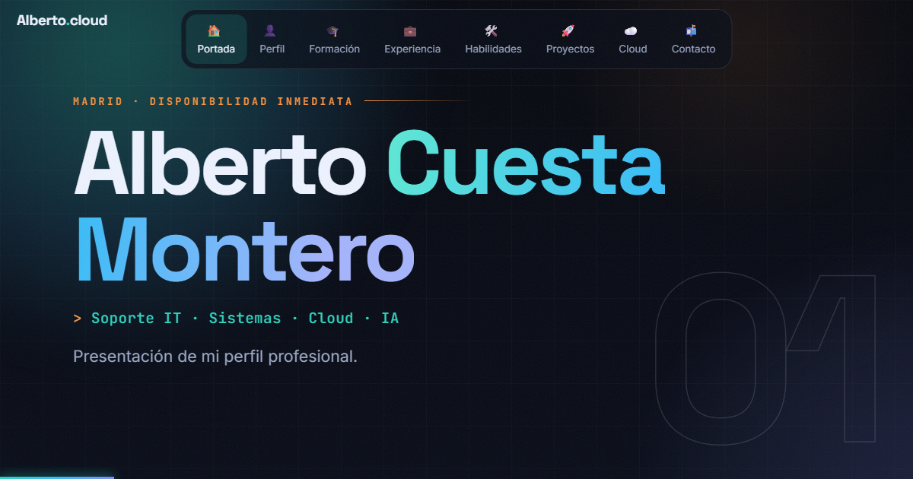

# Alberto Cuesta Montero

Soporte IT · Sistemas · Cloud · IA. Madrid. Disponibilidad inmediata, turnos incluido 24x7.

**Presentación en vivo:** https://albeertx.github.io/portfolio/

También alojada en AWS (S3 y CloudFront): https://dqy9jq042m8oh.cloudfront.net

---

## Empieza aquí

| Proyecto | Qué hay dentro | Ver la web |
|---|---|---|
| [01 Presentacion](01%20Presentacion) | Mi presentación profesional, en web y en PDF. | [Abrir](https://albeertx.github.io/portfolio/01%20Presentacion/Presentacion%20Alberto%20Cuesta.html) |
| [02 Web en AWS (S3 y CloudFront)](02%20Web%20en%20AWS%20%28S3%20y%20CloudFront%29) | El proyecto cloud que aloja esa presentación: cómo está montado y por qué. | [Abrir](https://dqy9jq042m8oh.cloudfront.net) |
| [03 Servidor Linux en AWS](03%20Servidor%20Linux%20en%20AWS) | Ubuntu en EC2 con nginx, firewall, usuario sin permisos de administrador y SSH solo con clave. | [Abrir](https://albeertx.github.io/portfolio/03%20Servidor%20Linux%20en%20AWS/web/) |
| [04 Publicacion automatica GitHub Actions](04%20Publicacion%20automatica%20GitHub%20Actions) | Al subir un cambio a GitHub, la presentación se publica sola en AWS (S3 y CloudFront), con acceso OIDC y sin claves guardadas. | [Abrir](https://albeertx.github.io/portfolio/04%20Publicacion%20automatica%20GitHub%20Actions/web/) |
| [05 Sistema de tickets GLPI](05%20Sistema%20de%20tickets%20GLPI) | Help Desk con GLPI en una máquina virtual Ubuntu: entidades, categorías, 8 tickets de ejemplo y 4 guías de resolución de problemas. | [Abrir](https://albeertx.github.io/portfolio/05%20Sistema%20de%20tickets%20GLPI/web/) |
| [06 Red segura de laboratorio](06%20Red%20segura%20de%20laboratorio) | Cortafuegos OPNsense con LAN, DMZ y VPN WireGuard en máquinas virtuales: reglas, 11 pruebas con capturas y registro de bloqueos. | [Abrir](https://albeertx.github.io/portfolio/06%20Red%20segura%20de%20laboratorio/web/) |

Cada proyecto con página web tendrá aquí su enlace "Abrir", que se ve funcionando sin tener que leer el código.

## Perfil

- Máster - Programa Avanzado en Cloud Computing, AWS y Azure (UNIR, título propio, 450 h).
- Grado Superior DAM y Grado Medio SMIR.
- Prácticas en ciberseguridad y desarrollo web (firewalls, DMZ, VPN) y en redes e infraestructura.
- Inglés B2.

## En curso

- Automatización con IA: aplicaciones de gestión con Claude Cowork y Python, como un agente de candidaturas.
- Páginas web a medida para negocios: una academia de refuerzo y una barbería (borradores sin publicar).
- Vídeos con IA: imagen con Higgsfield, voz con ElevenLabs y edición con CapCut.

## Próximos proyectos (planificados)

Se irán añadiendo como carpetas nuevas cuando estén hechos, en este orden:

1. Laboratorio de Active Directory (Windows Server, Hyper-V, GPO)
2. Microsoft 365, Entra ID e Intune
3. PowerShell para altas y bajas de usuarios desde CSV
4. Monitorización con Zabbix y Grafana, con alertas por Telegram
5. SIEM con Wazuh y ataques simulados
6. Infraestructura como código con Terraform
7. Automatización de servidores con Ansible
8. Backup y recuperación ante desastres hacia S3
9. Docker y Kubernetes ligero (k3s)

## Contacto

- Correo: albertocuesta02@gmail.com
- LinkedIn: https://www.linkedin.com/in/alberto-cuesta-montero
- GitHub: https://github.com/albeertx
